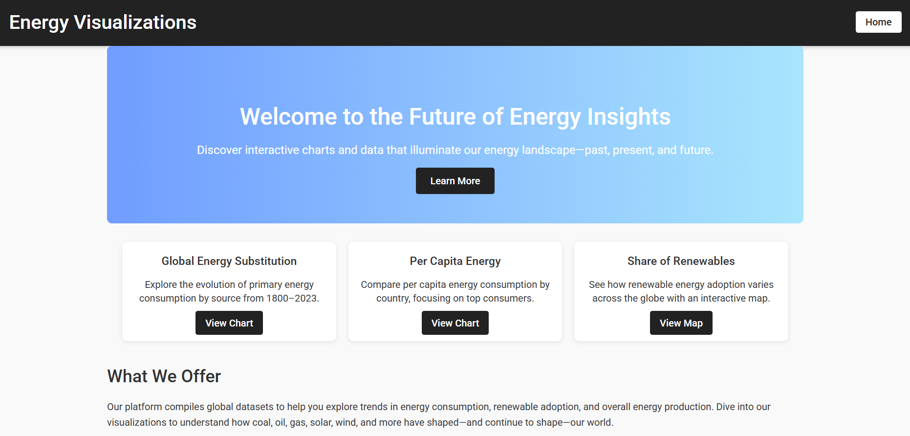
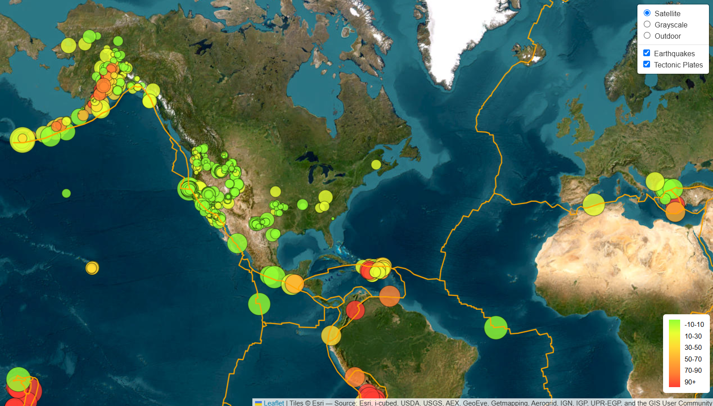
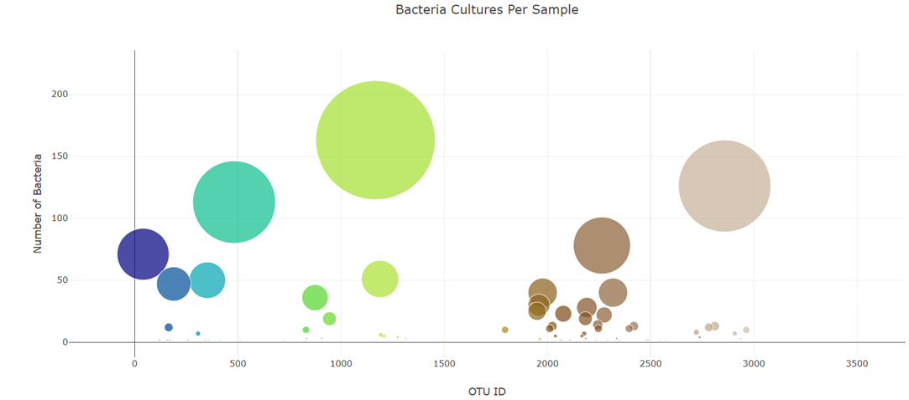

# Hi, I'm Christine Bilinski

**Customer Operations | Process Improvement | Data Reporting**

I work in customer support and enjoy finding simpler ways to get things done. My background includes customer service, administration, bookkeeping and survey reporting.

At Haldimand-Norfolk REACH, I recorded survey results and created annual charts to summarize responses. I now work as a Live Services Agent at ServiceTitan, coordinating scheduling and service support.

I completed the University of Toronto Data Analytics Bootcamp. The projects below show my training and continued learning in spreadsheets, SQL, Python and data visualization.

[Portfolio website](https://cbilinski101.github.io/) · [LinkedIn](https://linkedin.com/in/christine-b-19367b31b) · [Resume (PDF)](https://cbilinski101.github.io/Christine_Bilinski_Resume.pdf)

---

## Featured Projects

### Volleyball Scorekeeping Helper — Personal Project

I’m continuing to use my newly developed technical skills to build a scorekeeping app for my child’s volleyball games. This hobby project combines learning, problem-solving and testing during real games.

The app guides lineups, scoring and substitutions, and previews an OVA-style score sheet. The official paper sheet and referee remain the reference for match decisions.

[Explore the app](https://volleyball-helper-u14-u15-test.vercel.app/)

### Customer Support Dashboard

A portfolio project using sample support-ticket data, SQL queries and charts to explore ticket volume, status, issue categories, response times and customer satisfaction.

[View project and charts](https://github.com/cbilinski101/customer-support-dashboard) · [SQL queries](https://github.com/cbilinski101/customer-support-dashboard/blob/main/support_dashboard.sql)

### Excel Crowdfunding Analysis

Spreadsheet analysis of campaign outcomes, categories and monthly trends, with pivot tables, charts and a discussion of dataset limitations.

[View project](https://github.com/cbilinski101/excel-challenge)

### SQL Data Modeling and Analysis — Bootcamp Project

Created a relational database from CSV files, defined table relationships and used SQL to answer questions about employee and department data.

[View project](https://github.com/cbilinski101/sql_challenge)

### Energy Data Dashboard

Interactive visualizations exploring global energy consumption and renewable electricity trends.

[Live dashboard](https://cbilinski101.github.io/Project-3/) · [Repository](https://github.com/cbilinski101/Project-3)

## More Visualization Projects

### Earthquake Visualization Map

An interactive Leaflet map showing earthquake locations and magnitudes.

[Live demo](https://cbilinski101.github.io/leaflet-challenge/) · [Repository](https://github.com/cbilinski101/leaflet-challenge)

### Biodiversity Dashboard

An interactive Plotly dashboard for exploring belly-button bacterial samples.

[Live dashboard](https://cbilinski101.github.io/belly-button-challenge/) · [Repository](https://github.com/cbilinski101/belly-button-challenge)

---

## Skills & Tools

**Work experience:** Customer service, scheduling, administration, survey reporting and annual charts.

**Training and projects:** Excel, Google Sheets, SQL, Python, dashboards and data visualization.

**Other project tools:** JavaScript, Plotly, Leaflet, HTML, CSS and GitHub Pages.

I’m interested in roles that combine customer operations, reporting and practical problem-solving while giving me room to develop my analytics skills.

## Connect With Me

[LinkedIn](https://linkedin.com/in/christine-b-19367b31b) · [Portfolio](https://cbilinski101.github.io/) · [GitHub](https://github.com/cbilinski101) · [Email](mailto:cbilinski101@gmail.com)
