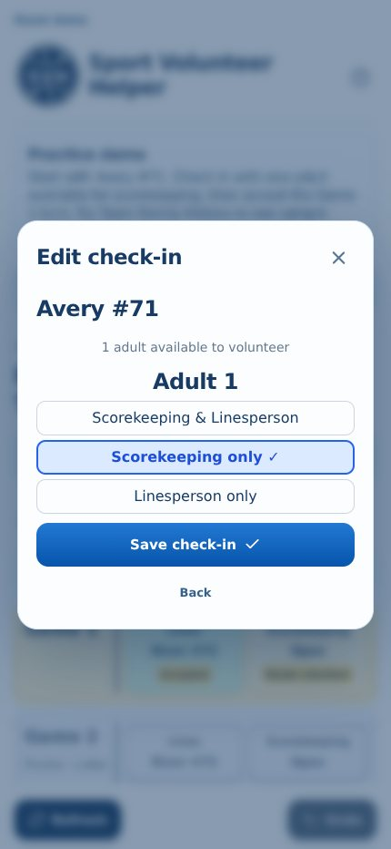
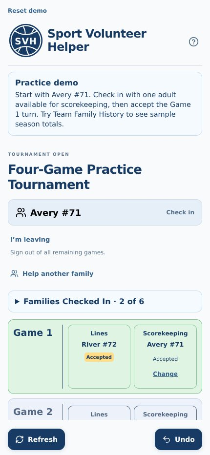
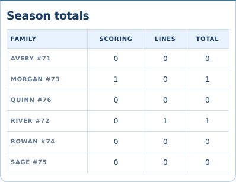

# Hi, I'm Christine Bilinski

**Practical problem-solving | Useful tools | Clear information**

I notice the steps that make a task harder than it needs to be, then work on ways to make it simpler. I enjoy organizing information, reducing repeated work, and building tools around the person using them.

My background in customer service, administration, bookkeeping and reporting helps me understand everyday work problems. My personal projects give me a way to turn that experience into something practical: identify a need, build a solution, test it, and improve it.

[Explore my portfolio](https://cbilinski101.github.io/) · [Discuss a small project](mailto:cbilinski101@gmail.com)

---

## Personal projects & practical solutions

### Sport Volunteer Helper
*Making team volunteering fairer, clearer and easier to join.*

I started this app to help share volunteer duties fairly, without leaving one person responsible for chasing volunteers or deciding whose turn it should be.

Families choose when they’re available and whether they can help with scorekeeping, linesperson duties, or both. No adult names are needed—families simply check in using their child’s first name and jersey number.

The app uses availability and previous volunteering to organize turns. Schedules and volunteering history are accessible to everyone on the team, making it easier to see how responsibilities are shared throughout the season.

My goal is to encourage participation by letting parents offer the help they’re comfortable giving, without feeling pressured to do everything.

I’m developing the app with AI assistance and refining it through testing and parent feedback.

**[Try the practice demo](https://sport-volunteer-helper-demo.vercel.app/)**

Choose Avery #71, check in as a scorekeeping volunteer, and accept the Game 1 turn. The demo uses fictional families and keeps your progress in your browser.

**Screenshots from the practice demo**

**Choose how to help**  

**See the live schedule**  

**Review season totals**  

[See how it works](https://cbilinski101.github.io/sport-volunteer-helper.html)

### Volleyball Helper
*Helping parents make sense of volleyball scorekeeping.*

I started this project after discovering how much there is to learn when keeping score for a volleyball team. For a parent with no experience, following the score, serving order, rotations and substitutions can quickly become overwhelming.

Volleyball Helper brings those tasks together in a guided app. You can set up a match or jump into a practice game with sample teams to explore how it works.

This is an ongoing hobby project, developed with AI assistance and shaped by my experience as a parent learning to score. It currently focuses on U14/U15 indoor volleyball—a small part of a much larger sport. It is usable as a companion for parents, but it is still experimental and does not replace the official score sheet.

I’d love to expand it to other age groups and game formats over time. Volleyball has many rules and variations, so that will take continued learning, testing and development. For now, I’m building something useful, trying it out and improving it along the way.

[Try the app](https://volleyball-helper-u14-u15-test.vercel.app/) · [About this project](https://cbilinski101.github.io/volleyball-helper.html)

### Fraud Risk Intelligence Dashboard

An interactive demonstration that lets a visitor enter fictional transaction details, generate a model prediction, and explore prediction history and charts. It shows how analytical work can become a tool someone can try and understand.

This is a portfolio demonstration, not a production fraud-detection service. Predictions do not establish real-world accuracy. Demo history is shared across visitors and can reset when the service restarts.

[Open the dashboard](https://fraud-risk-dashboard.onrender.com/) · [View the project](https://github.com/cbilinski101/fraud-api)

## Small project enquiries

I'm interested in clearly scoped projects that make everyday work easier: improving a spreadsheet or tracker, organizing information, simplifying repeated steps, or exploring a small practical tool.

I start by understanding the problem, agreeing on a manageable first piece, and being clear about what I can deliver. The projects above are portfolio work, rather than paid client commissions.

[Tell me what you're trying to make easier](mailto:cbilinski101@gmail.com)

---

## Education & school projects

I completed the University of Toronto Data Analytics Bootcamp. These school projects show my foundation in Excel, SQL, Python, reporting and data visualization.

| Project | Focus | Explore |
| --- | --- | --- |
| Customer Support Dashboard | Sample support-ticket data, SQL queries and reporting charts | [Project and charts](https://github.com/cbilinski101/customer-support-dashboard) |
| Excel Crowdfunding Analysis | Pivot tables, charts, campaign outcomes and dataset limitations | [Project](https://github.com/cbilinski101/excel-challenge) |
| SQL Data Modeling and Analysis | Relational tables and queries using employee data | [Project](https://github.com/cbilinski101/sql_challenge) |
| Energy Data Dashboard | Global energy consumption and renewable electricity trends | [Live dashboard](https://cbilinski101.github.io/Project-3/) |
| Earthquake Visualization Map | Interactive geographic visualization with Leaflet | [Live map](https://cbilinski101.github.io/leaflet-challenge/) |
| Biodiversity Dashboard | Interactive charts exploring bacterial samples | [Live dashboard](https://cbilinski101.github.io/belly-button-challenge/) |

## Spreadsheet experience

I adapt spreadsheets between Excel and Google Sheets, adjusting formulas that are not directly interchangeable and checking results after conversion.

## Employment & professional background

My experience includes customer service, scheduling, administration, bookkeeping and survey reporting. At Haldimand-Norfolk REACH, I recorded survey results and created annual charts. I now work as a Live Services Agent at ServiceTitan.

I'm interested in remote customer support, technical support and operations roles where I can combine customer experience with practical problem-solving and continue developing my product knowledge.

[View / print résumé](https://cbilinski101.github.io/resume.html) · [LinkedIn](https://linkedin.com/in/christine-b-19367b31b) · [Email](mailto:cbilinski101@gmail.com)
